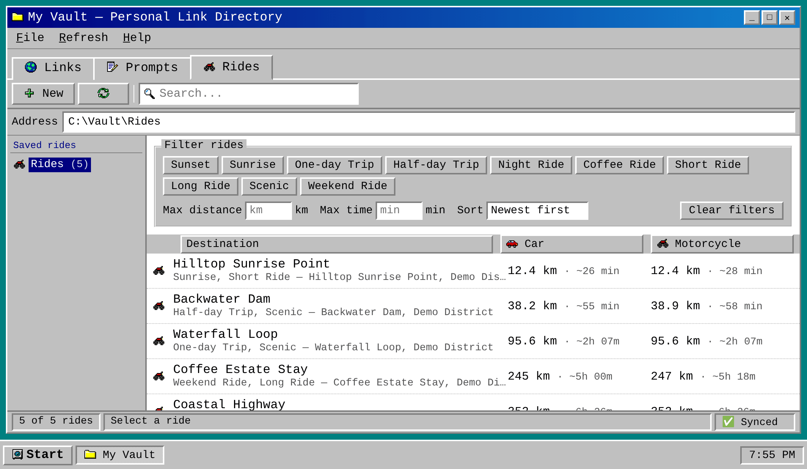
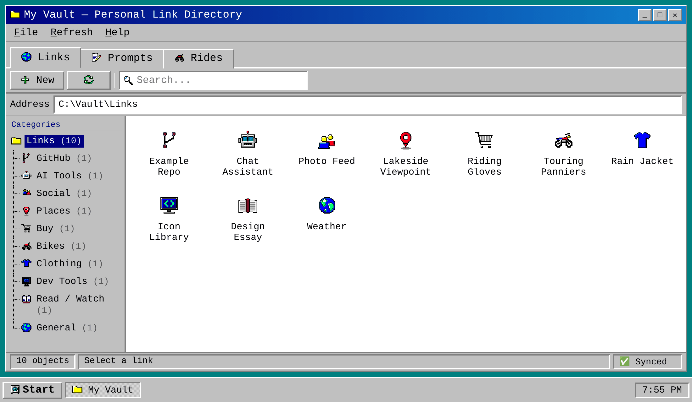
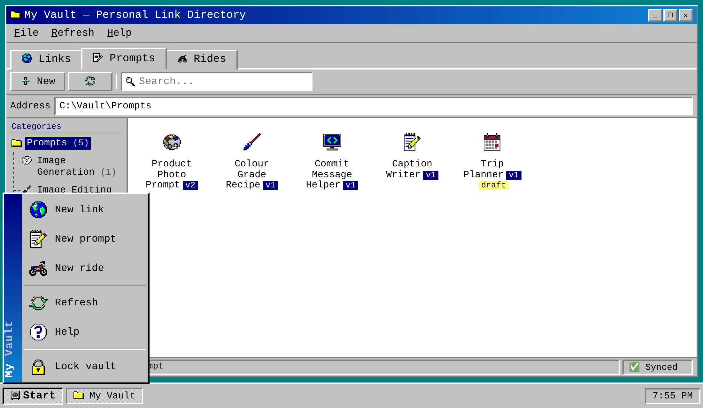
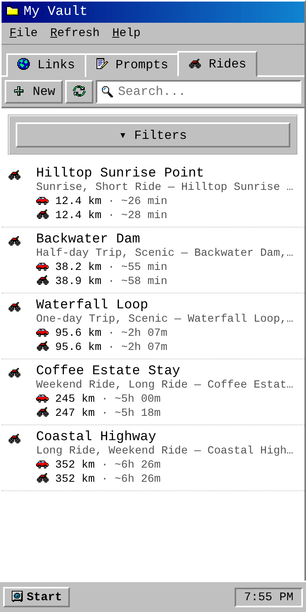

# 🗂️ My Vault

> A private, Windows 95-style personal directory for **links**, **AI prompts** and **bike rides** — backed by your own Google Sheet, hosted on Vercel, and usable from your phone, tablet or desktop.




<p align="center">
  
  
</p>
<p align="center">
  
</p>

<sub>Screenshots use made-up demo data.</sub>

---

## ✨ Features

**🔗 Links**
- Save anything with a URL, sorted into categories shown as an Explorer-style folder tree with item counts
- Each link shows its site's own icon (falls back to a pixel category icon)
- Real-time search across titles, URLs and notes

**📝 Prompts**
- Keep AI prompts with category, tool, tags, status and notes
- **Save as New Version** keeps the old one and bumps the version number
- One-click copy; attach a result image (resized in the browser, stored on your Google Drive)

**🏍️ Rides**
- Paste a Google Maps link (full or `maps.app.goo.gl` short link) or just type a place name
- Get **car and motorcycle** distance and an estimated time from your home base
- Tag rides (Sunrise, Coffee Ride, Weekend Ride…), filter by tag, max distance or max time, and sort by distance
- Edit a ride's name, tags or link later

**🪟 Everywhere**
- Hand-drawn Windows 95-style pixel icons (32×32 and 16×16, all original)
- Working **Start menu**, window buttons (minimise to taskbar, maximise, close = lock) and keyboard support
- Responsive from 360 px phones to desktop; long-press on touch screens, right-click on desktop
- Installable: **Add to Home screen** gives it an app icon and opens it full-screen
- **Lock vault** from the Start menu forgets the key on that device

---

## 🔒 Security

The vault is private by design — only someone with your vault key can read or change anything.

- **Vault key** — every API request must carry `VAULT_API_KEY`, checked on the server in constant time. Ten wrong keys from one place lock that place out for 15 minutes.
- **Google credentials never reach the browser** — the serverless functions talk to Google with OAuth tokens stored only in Vercel.
- **Server-side validation** — text is length-capped, non-text fields are dropped, links must be real `http(s)` addresses, IDs are checked, sheet writes are stored as plain text (no formulas).
- **Safe rendering** — everything from your sheet is escaped before it's shown; only `http(s)` links can be opened, in a tab that can't reach back into the vault.
- **Uploads** — only JPEG, PNG, WebP or GIF up to ~3 MB.
- **Headers** — strict Content-Security-Policy, HSTS, `X-Frame-Options: DENY`, `nosniff`, `no-referrer`, a locked-down Permissions-Policy, and `no-store` on all API responses.
- **Not indexed** — `robots.txt`, a `noindex` meta tag and an `X-Robots-Tag` header keep search engines out.
- **Change log** — every add, edit, delete and upload is written to the function log and to a `Log` tab in your sheet.

> Uploaded result images are shared as "anyone with the link" on Drive so the page can display them. The links are unguessable, but anyone who has one can view that image.

---

## 📁 Project structure

```
vault/
├── index.html          ← The whole app: HTML + CSS + vanilla JS, no build step
├── 404.html            ← Win95-style "page not found" dialog
├── api/
│   ├── sheets.js       ← Links / prompts / rides storage + image upload (Google Sheets & Drive)
│   └── distance.js     ← Ride distance & time (OpenStreetMap: Nominatim, OSRM, Valhalla)
├── icons/              ← Pixel icons: <name>.svg (32×32) and <name>-16.svg (16×16)
├── docs/               ← README screenshots
├── favicon.*, icon-*.png, apple-touch-icon.png, site.webmanifest   ← Tab & home-screen icons
├── robots.txt          ← Blocks search engines
├── vercel.json         ← Security headers
└── .env.example        ← Every environment variable, explained
```

---

## 🚀 Setup

About 20 minutes. Do the steps in order.

### 1 — Create the Google Sheet

Create a sheet with **four tabs**. Names are case-sensitive; put these headers in **row 1**.

| Tab | Columns (A → …) |
|---|---|
| `Vault` | `id` · `title` · `url` · `cat` · `note` · `date` |
| `Prompts` | `id` · `title` · `category` · `tool` · `tags` · `status` · `version` · `prompt` · `notes` · `date` · `result` |
| `Rides` | `id` · `destination` · `link` · `car_km` · `car_min` · `bike_km` · `bike_min` · `date` · `name` · `tags` |
| `Log` | `time` · `action` · `type` · `id` · `title` · `ip` |

Copy the **Sheet ID** from its URL — the part between `/d/` and `/edit`:
```
https://docs.google.com/spreadsheets/d/THIS_PART/edit
```

### 2 — Create a Google Cloud project and enable the APIs

1. At [console.cloud.google.com](https://console.cloud.google.com) create a new project (e.g. `my-vault`).
2. **APIs & Services → Library** → enable **Google Sheets API** and **Google Drive API**.

### 3 — Create OAuth credentials

1. **APIs & Services → Credentials → Create credentials → OAuth client ID**.
2. If asked to configure the consent screen: choose **External**, enter an app name and your email, add yourself as a **test user**, then **publish** the app.
   > ⚠️ While the consent screen is in *Testing*, refresh tokens expire after 7 days and the vault stops working with `invalid_grant`. Publishing avoids that.
3. Application type **Web application**; under **Authorized redirect URIs** add `https://developers.google.com/oauthplayground`.
4. Save the **Client ID** and **Client Secret**.

> You don't need an *API key* — the vault only uses OAuth. Don't create one, and never commit one.

### 4 — Get a refresh token

1. Open the [OAuth Playground](https://developers.google.com/oauthplayground) → ⚙️ → tick **Use your own OAuth credentials** → paste your Client ID and Secret.
2. Select these two scopes, then **Authorize APIs** and sign in:
   - `https://www.googleapis.com/auth/spreadsheets`
   - `https://www.googleapis.com/auth/drive.file`
3. **Exchange authorization code for tokens** → copy the **Refresh token**.

### 5 — Make a vault key

This is the password you'll type into the vault. Make it long and random — at least 20 characters. For example:
```
node -e "console.log(require('crypto').randomBytes(24).toString('base64url'))"
```

### 6 — Deploy on Vercel

1. At [vercel.com](https://vercel.com) → **Add New Project** → import this repo → **Deploy**.
2. **Settings → Environment Variables** — add these, ticked for **Production** and **Preview**:

   | Variable | Value |
   |---|---|
   | `VAULT_API_KEY` | Your vault key from step 5 |
   | `GOOGLE_SHEET_ID` | Sheet ID from step 1 |
   | `GOOGLE_CLIENT_ID` | From step 3 |
   | `GOOGLE_CLIENT_SECRET` | From step 3 |
   | `GOOGLE_REFRESH_TOKEN` | From step 4 |
   | `ALLOWED_ORIGIN` | *(Production only, optional)* your site, e.g. `https://your-vault.vercel.app` |

3. **Deployments → ⋯ → Redeploy** so the variables take effect.

### 7 — Set your home base for rides

Ride distances are measured from the `ORIGIN` coordinates near the top of [`api/distance.js`](api/distance.js). Change them to your own starting point:
```js
const ORIGIN = { lat: 12.372889, lng: 76.585028 };
```

### 8 — Open it 🎉

Go to your Vercel URL, enter your vault key, and start saving. On your phone, use **Add to Home screen**.

---

## ⌨️ How to use

| Action | Desktop | Phone / tablet |
|---|---|---|
| Add something | **+ New** (or `Ctrl+N`), or Start → New link / prompt / ride | **+ New** |
| Open a link / copy a prompt | Double-click, or select and press `Enter` | Tap |
| Copy, edit, delete | Right-click (or `Shift+F10`) | Long-press |
| Save a prompt revision | Right-click → **Save as New Version** | Long-press → **Save as New Version** |
| Filter | Click a folder in the sidebar | Category bar at the bottom |
| Filter rides | Tag buttons, max km / minutes, sort | **▾ Filters** |
| Refresh from the sheet | 🔄, or Start → Refresh | 🔄 |
| Lock the vault | Start → Lock vault, or the ✕ window button | Start → Lock vault |

**About ride times:** they're estimates from free OpenStreetMap routing (no live traffic). The vault averages two routing services that err in opposite directions; highway trips land within a few minutes of Google Maps, city trips can be a little off at rush hour.

---

## 🛠️ Tech stack

| Layer | Tech |
|---|---|
| Frontend | One HTML file — HTML, CSS, vanilla JS. No framework, no build step |
| Backend | Two Vercel serverless functions (Node.js 24), zero npm dependencies |
| Data | Your private Google Sheet (via OAuth) |
| Images | Google Drive (`drive.file` scope — the app only sees files it created) |
| Routing | [Nominatim](https://nominatim.org) (places), [OSRM](https://project-osrm.org) and [Valhalla](https://github.com/valhalla/valhalla) (car & motorcycle) |
| Site icons | Google and DuckDuckGo favicon services |
| Hosting | Vercel (free tier) |

---

## 🙏 Credits

- Map data © [OpenStreetMap](https://www.openstreetmap.org/copyright) contributors.
- Routing by the public [OSRM](https://project-osrm.org) and [FOSSGIS Valhalla](https://valhalla1.openstreetmap.de) servers; geocoding by [Nominatim](https://nominatim.org). Please respect their usage policies — the vault rate-limits itself.
- All icons are original pixel art made for this project.

---

## 📄 License

[MIT](LICENSE) © 2026 Akshobya A S
